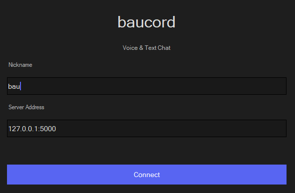
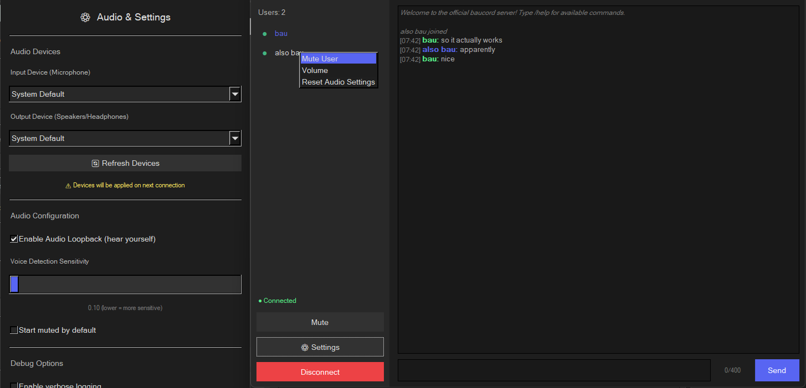

## Description

A lightweight voice and text chat application built with Rust, featuring a native GUI and low-latency voice communication.

> This was 99% vibe coded in a single night. Use at your own risk.

## Features

- **Voice Chat** with Voice Activity Detection (VAD)
- **Text Chat** with styled messages and timestamps
- **Native GUI** using FLTK with dark theme
- **Per-user audio controls** (mute/volume adjustment via right-click)
- **Ultra lightweight** - ~3.5MB RAM usage
- **Low latency** - 10ms audio frames for responsive voice chat
- **Cross-platform** - Works on Windows, Linux, and macOS

## Screenshots


*Connect to server and nickname setup*


*Main chat interface with user list,voice indicators and settings page*

## Building and Running

### Prerequisites

- Rust 1.87 or later
- CMake (for FLTK)

### Server

```bash
cargo run --bin server --release
```

The server starts on `127.0.0.1:5000` by default. Configuration can be adjusted in [config.yaml](config.yaml).

### Client
```bash
cargo run --bin client --release
```

Enter your nickname and server address (e.g., `127.0.0.1:5000`) to connect.

--
### What works

- Voice transmission starts automatically when you speak (VAD enabled)
- "Mute" to toggle your microphone
- Right-click on users to mute or adjust their volume individually
- Very basic resampling to work with different audio interfaces (its bad)
- Messages support up to 400 characters
- Audio settings via the ⚙ Settings button
- Configuration for VAD sensitivity, audio loopback, and default mute state
- Settings persist between sessions (stored in `~/.config/baucord/`, or `%APPDATA%/Roaming` in windows)


---
License: Apache 2.0
```
Unless required by applicable law or agreed to in writing, software
distributed under the License is distributed on an "AS IS" BASIS,
WITHOUT WARRANTIES OR CONDITIONS OF ANY KIND, either express or implied.
See the License for the specific language governing permissions and
limitations under the License.
```